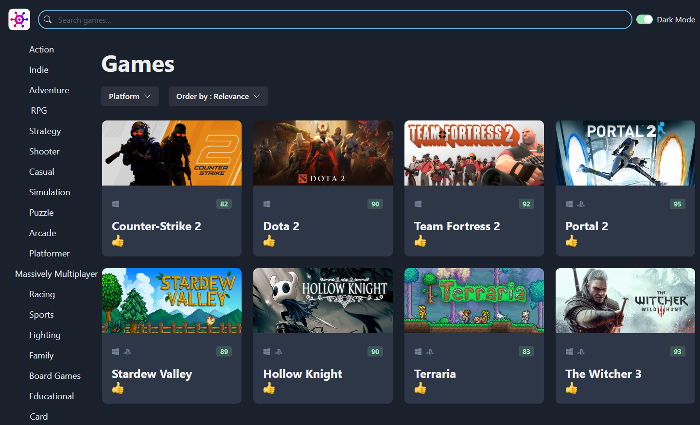

# Game Hub

Game Hub 是一个游戏目录前端。可以用关键词搜索游戏，按类型或平台筛选，并调整排序。页面还提供响应式游戏卡片和浅色、深色切换。

A responsive game discovery frontend with keyword search, genre and platform filters, sorting, and light and dark themes.

这是我的 React 学习项目。我把 Mosh Hamedani 的 [React 课程 GameHub 项目](https://github.com/mosh-hamedani/game-hub) 作为练习题，用不同的工具组合从头实现。

I built this as a self-directed learning challenge: implement [GameHub](https://github.com/mosh-hamedani/game-hub), featured in the [React course by Mosh Hamedani](https://codewithmosh.com/), from scratch using different tooling.

截图来自本仓库的本地生产构建。截图时为 RAWG 请求提供示例数据，以便展示卡片和搜索体验。封面来自 Steam。

Captured from a local production build of this repository with sample RAWG responses. Cover art is sourced from Steam.

## 技术栈 / Stack

React 18 · TypeScript · Vite · Chakra UI · Axios · RAWG

- `src/App.tsx` 管理搜索、筛选和排序共用的查询状态。
- `src/components/` 包含目录、筛选器、搜索框和游戏卡片。
- `src/hooks/` 管理数据请求和加载状态，`src/service/` 封装 RAWG 客户端及图片地址。

## 本地运行 / Run locally

~~~sh
npm ci
npm run dev
~~~

使用以下命令构建并预览静态产物。运行时游戏数据来自 RAWG，需要可访问的 API 服务。

~~~sh
npm run build
npm run preview
~~~

## 部署 / Deploy

在 Vercel 中导入仓库，选择 Vite 框架预设，构建命令使用 `npm run build`，输出目录使用 `dist`。
